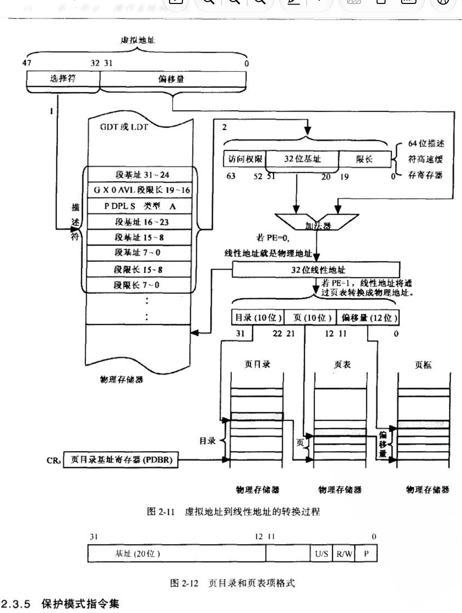

内容：内存映射与缺页异常

mm/vmscan.c

mm/swapfile.c

mm/shmem.c

arch/i386/mm/init.c

mm/mprotect.c

进一步而言，我确定了我所负责范围的内存映射与缺页异常链路所涉及的文件及函数，可以以如下作为参考：

mm/mmap.c

arch/i386/mm/fault.c

mm/memory.c

mm/page_alloc.c

mm/page_io.c


## 基本定义

在阅读源码之前，需要先了解基本定义。

### 内存映射

是指建立虚拟地址与物理内存之间的对应关系，使进程能够通过虚拟地址访问实际内存。

### 缺页异常

是指 CPU 在访问虚拟地址时，发现所需的地址转换不存在，或者访问违反页表保护规则，从而触发的处理器异常。

缺页异常属于内存映射的中间环节。

---

内存映射包含两个部分：操作系统建立映射、MMU 执行地址转换

前者是由数据结构及其内存中的状态维护的静态映射，后者是由算法进行地址转换的动态过程。

对于后者的输入输出：

\[ \boxed{\text{线性地址}+\text{页表信息}\longrightarrow\text{物理地址}} \]

在Linux 2.4.18中，页表结构为：页目录1024项，页索引1024项，一个页4096字节。

对于汇编指令

```
mov eax, [0x00403008]
```

含义为将虚拟地址的`0x00403008`中4B大小的内容存入`eax`寄存器。

```
页目录				  页索引		  	  页内
10 bit			  10 bit	      12 bit
0000 0000 01' 00 0000 0011' 0000 0000 1000
           1             3               8
```

因此虚拟地址映射语义为：页目录1号表项，页项3号表项，页内第8字节起始（不包含，即访问编号为8 9 10 11的字节，从0开始编号）


现在提供页号，CPU硬件通过TLB查询。

若hit = 0（未命中）

写入，映射

越界，非法：触发PF

若hit = 1（命中）

映射

硬件完成了整个查表映射以及触发异常的流程，软件的职责是维护表的内容。

下图为参考书目的虚拟地址映射原理图，我负责的内存映射和缺页异常部分属于右下角。



**内存映射代码**

现在明确了软硬件职责，知道了内存映射代码部分所做的是维护表，众所周知表的基本操作有：增删改查。在此基础上我们还需要知道，表的维护操作何时被触发。

具体学习内容：

1. 数据结构：`mm_struct`、`vm_area_struct`、页目录和页表。
2. 创建映射：程序通过 `mmap()` 等接口申请映射，内核建立相应的虚拟内存区域。
3. 查找映射：根据虚拟地址查找对应的 VMA 或页表项。
4. 修改映射：修改区域权限、调整映射范围或更新页表项。
5. 删除映射：通过 `munmap()` 等操作解除映射并释放相关资源。
6. 触发时机：程序发起系统调用、加载程序、创建进程，以及缺页异常处理等需要建立或调整映射的场景。

重点源码：

- `mm/mmap.c`：虚拟内存区域的建立和管理。
- `mm/memory.c`：页表与物理页面映射的管理。

**缺页异常代码**

核心问题：CPU 报告缺页异常后，Linux 如何判断原因并进行处理？

主要研究：

1. 异常入口：CPU 触发 `#PF`，进入内核处理程序。
2. 获取异常信息：读取故障地址、错误码等。
3. 判断合法性：检查 VMA 是否存在、访问权限是否允许。
4. 分类处理：
   - 页面尚未建立映射：按需分配或取得页面。
   - 页面已经换出：从交换区恢复。
   - 写入写时复制页面：必要时复制物理页面。
   - 非法访问：发送相应信号或执行内核错误处理。
5. 恢复执行：成功修复后，返回并重新执行发生异常的指令。

重点源码：

- `arch/i386/mm/fault.c`：`do_page_fault()`
- `mm/memory.c`：`handle_mm_fault()`、`do_no_page()`、`do_swap_page()`、`do_wp_page()` 等。


## 内存映射代码分析

目录：

1. 数据结构：`mm_struct`、`vm_area_struct`、页目录和页表。
2. 创建映射：程序通过 `mmap()` 等接口申请映射，内核建立相应的虚拟内存区域。
3. 查找映射：根据虚拟地址查找对应的 VMA 或页表项。
4. 修改映射：修改区域权限、调整映射范围或更新页表项。
5. 删除映射：通过 `munmap()` 等操作解除映射并释放相关资源。
6. 触发时机：程序发起系统调用、加载程序、创建进程，以及缺页异常处理等需要建立或调整映射的场景。

### 数据结构

| 数据结构                  | 源码定义位置              | 主要职责                          |
| ------------------------- | ------------------------- | --------------------------------- |
| `mm_struct`               | `include/linux/sched.h`   | 管理一个进程地址空间的整体状态    |
| `vm_area_struct`          | `include/linux/mm.h`      | 描述一段连续的虚拟内存区域（VMA） |
| `pgd_t`、`pmd_t`、`pte_t` | `include/asm-i386/page.h` | 表示页目录项、页表中间项和页表项  |
| `struct page`             | `include/linux/mm.h`      | 描述一个物理页面的管理状态        |
| `vm_operations_struct`    | `include/linux/mm.h`      | 提供映射区域的操作回调            |

#### `mm_struct`：进程地址空间的管理单元

源码：`include/linux/sched.h`

**链表头**

它负责记录一个地址空间中有哪些 VMA、页目录在哪里、使用了多少内存，以及映射操作所需的同步状态。

关键字段如下：

```c
struct mm_struct {
    struct vm_area_struct *mmap;
    rb_root_t mm_rb;
    struct vm_area_struct *mmap_cache;
    pgd_t *pgd;

    // 以下还有引用计数、锁、内存统计、
    // 代码段和堆栈边界等字段
};
```

| 字段              | 作用                                 |
| ----------------- | ------------------------------------ |
| `mmap`            | VMA 链表的头指针                     |
| `mm_rb`           | 管理 VMA 的红黑树根节点              |
| `mmap_cache`      | 缓存最近一次 `find_vma()` 的查询结果 |
| `pgd`             | 当前地址空间的页目录基址（内核指针） |
| `map_count`       | VMA 的数量                           |
| `mmap_sem`        | 保护内存区域管理操作的读写信号量     |
| `page_table_lock` | 保护页表等状态的自旋锁               |
| `total_vm`、`rss` | 统计虚拟页面总量、驻留物理页面数量等 |

#### `vm_area_struct`：单个虚拟内存区域

源码：`include/linux/mm.h`

**链表节点**

一个进程的地址空间会划分成多个 VMA，例如代码段、数据段、堆、栈和文件映射区域。

每个 VMA 负责记录一段连续虚拟地址范围的属性。

重要成员包括：

```c
struct vm_area_struct {
    struct mm_struct *vm_mm;
    unsigned long vm_start;					 
    unsigned long vm_end;						 
    struct vm_area_struct *vm_next;  
    pgprot_t vm_page_prot;
    unsigned long vm_flags;
    rb_node_t vm_rb;

    // 其余成员与共享映射、
    // 文件映射及操作回调有关
};
```

| 字段           | 含义                                     |
| -------------- | ---------------------------------------- |
| `vm_mm`        | 指向所属的 `mm_struct`                   |
| `vm_start`     | 映射区域起始虚拟地址                     |
| `vm_end`       | 映射区域结束地址，不包含该地址           |
| `vm_next`      | 指向下一个 VMA                           |
| `vm_rb`        | 使该 VMA 成为红黑树节点                  |
| `vm_flags`     | 映射区域的访问与管理属性                 |
| `vm_page_prot` | 建立页表映射时使用的页面保护属性         |
| `vm_file`      | 文件映射对应的文件对象，匿名映射通常为空 |
| `vm_pgoff`     | 映射在文件中的页偏移                     |
| `vm_ops`       | 指向该映射区域的操作函数集合             |

#### `pgd_t`、`pmd_t`、`pte_t`：页表项类型

源码：`include/asm-i386/page.h`

这是 Linux 用来表示分页结构中各级表项的数据类型。

在 32 位非 PAE 配置下，定义如下：

```c
typedef struct { unsigned long pgd; } pgd_t;			// 4 B
typedef struct { unsigned long pmd; } pmd_t;
typedef struct { unsigned long pte_low; } pte_t;  // 4 B
```

| 类型    | 作用                                           |
| ------- | ---------------------------------------------- |
| `pgd_t` | 表示页目录项，指向下一级页表                   |
| `pmd_t` | 表示页表中间层项；在非 PAE i386 中这一层被折叠 |
| `pte_t` | 表示页表项，保存物理页框地址及控制标志         |

#### `struct page`：物理页面管理结构

源码：`include/linux/mm.h`

它负责描述物理页面的管理状态。

关键字段示意：

```
typedef struct page {
    struct address_space *mapping;
    unsigned long index;
    atomic_t count;
    unsigned long flags;

    // 还有页面链表、等待队列、
    // 缓冲区及内存区域等成员
} mem_map_t;
```

| 字段      | 作用                               |
| --------- | ---------------------------------- |
| `mapping` | 关联文件页缓存或交换缓存等地址空间 |
| `index`   | 页面在所属映射中的索引             |
| `count`   | 页面引用计数                       |
| `flags`   | 页面状态标志                       |
| `lru`     | 页面回收相关链表节点               |
| `wait`    | 等待页面状态变化的队列             |
| `zone`    | 页面所属的物理内存区域             |

### 算法

#### do_mmap_pgoff

**链表增节点**